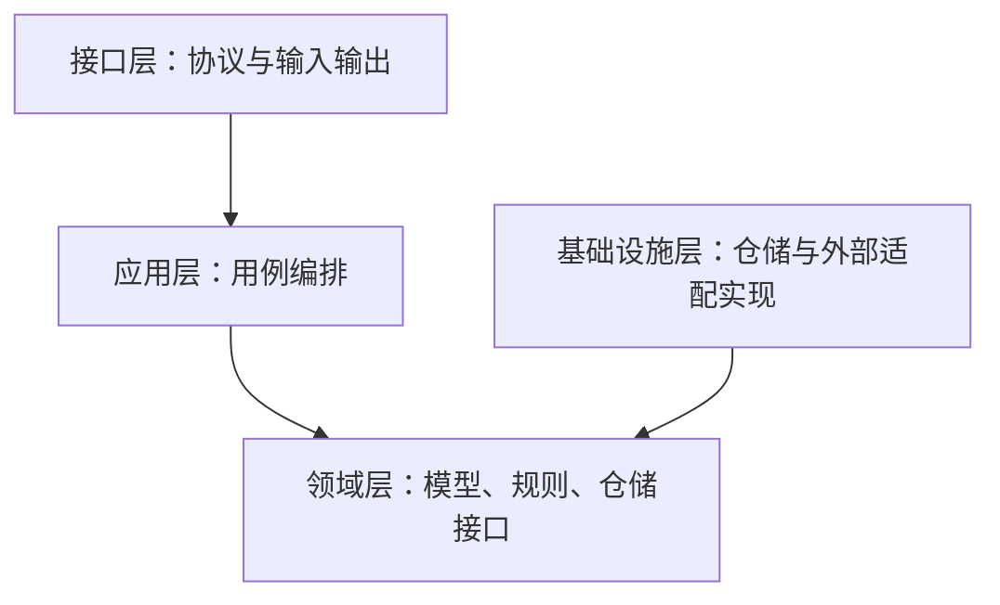

## 一、理解领域驱动设计的思维

### 1. DDD 是什么

领域驱动设计（Domain-Driven Design，DDD）是一种围绕业务来设计软件的方法。开发者和熟悉业务的人一起弄清概念、流程和规则，再把它们变成代码中的模型。

这里有三个关键词。

**领域，就是软件要处理的那部分业务。** 比如电商里的交易、库存、履约，各有各的规则。开发者需要和熟悉这些业务的人一起讨论，才能知道系统到底应该怎样工作。

**模型，是把业务中重要的部分整理出来。** 有哪些对象，对象之间是什么关系，可以做什么操作，有哪些限制，这些都属于模型。业务里所有的细节不必照搬进来，保留当前问题需要的部分就好。

**驱动，就是按这套模型来设计代码。** 业务上有区别的概念，代码里也应该能区分；一条规则变了，应该知道去哪里改。

比如，订单“取消”和“退款”都可能让用户最终拿回钱，但它们对应的状态、前置条件和后续动作不同。模型要保留这种差异，代码才能准确表达业务，而不只是修改几个状态字段。

Eric Evans 在《Domain-Driven Design》中系统整理了这套方法。领域建模在此之前就已经有很多实践，DDD 进一步强调：模型要用在代码里，并随着团队对业务的理解不断调整。相关背景可以看 [Martin Fowler 对 DDD 的介绍](https://martinfowler.com/bliki/DomainDrivenDesign.html)。

### 2. 为什么需要 DDD

业务做久了，开发中很费精力的一件事，就是搞清楚规则，以及改动一条规则会影响什么。

最初的需求可能只是“创建订单”。后来增加了优惠、库存预占、超时取消、部分退款和异常补偿。每个需求单独看都不复杂，组合起来却产生了许多状态与约束。

如果代码主要按页面、接口或数据库表来划分，规则就容易散落在不同地方：网页入口判断一次，后台入口再判断一次，批量处理又补一套条件。等规则变了，很容易改了这处、漏了那处。

沟通中也有类似的问题。大家都说“客户”，销售可能指有购买意向的人，财务关心付款主体，开发想到的是一张 `customers` 表。讨论时觉得说清楚了，写代码时才发现理解不同，最后只能返工或补特殊处理。

DDD 就是在解决这类问题：**把大家脑子里、需求文档里和零散代码里的业务规则整理清楚，让团队对照同一套模型讨论和开发。**

复杂的业务依然复杂，但至少可以减少理解不一致、规则到处重复、改动时不知道从哪里下手这些麻烦。

### 3. DDD 能带来什么

谈 DDD 时经常会提到共同语言、高内聚、低耦合。放到日常开发中，它们应该带来这些变化：


同一套术语贯穿需求、讨论、代码和测试，同一条规则由多个入口复用；改动时能判断影响范围，业务理解变化时也能调整模型和边界。设计投入则按复杂度分配：核心业务认真建模，简单功能保持简单。

有没有效果，看一次真实需求变更就比较直观：讨论是不是更容易说清楚，规则是不是更容易找到，改完是不是更容易验证。多了几个目录、用了多少设计模式，说明不了这些问题。

### 4. DDD 重视什么

#### 先看业务需要什么

做设计时，先弄清系统要支持哪些操作、必须保证哪些规则，再看用什么框架、数据库和部署方式。技术选择会影响实现，但业务概念不能只照着框架和表结构来定。

也要分清哪里值得多花时间。如果产品的核心是复杂的调度策略，就应该仔细设计调度模型；普通的资料维护功能，用直接的 CRUD 可能就够了。

#### 同一个词，大家理解一致

统一语言（Ubiquitous Language）说的是：在讨论同一部分业务时，业务人员和开发者用同一套术语，并且理解一致。需求怎么描述，方法怎么命名，测试怎么写，都应该能对得上。

比如“发布成功”，究竟是版本保存了，还是已经同步到运行引擎？如果这是两个阶段，就要用不同的名字和状态。名字定不下来时，往往还需要继续讨论业务。

#### 模型有自己的适用范围

大型系统中，同一个词可能承担不同职责。交易关心商品的销售价格，仓储关心商品的体积和库存位置。强行让所有团队共用一个庞大的“商品模型”，会让无关变化也相互影响。

限界上下文（Bounded Context）就是给这套模型划定适用范围。在范围内，概念要一致；与其他上下文协作时，再说清楚双方怎样交换和转换信息。可以参考 [Martin Fowler：Bounded Context](https://martinfowler.com/bliki/BoundedContext.html)。

#### 边做边修正模型

模型画出来以后，还要放进具体场景里试。设计正常流程时没发现的问题，到了取消、重试或回滚时可能就出现了。这时要考虑模型是否需要调整，不能一直靠补条件维持原来的设计。

所以业务人员和开发者需要持续交流。架构师提前画一张图，再让大家照着写，并不足以把业务理解清楚。

### 5. 什么场景值得使用 DDD

可以先看看有没有这些情况：业务规则多、变化频繁；对象有很多状态；一个操作要同时满足多个条件；不同角色对同一个概念理解不同；很多规则只有少数人说得清楚。

交易、审批、库存、计费、工作流中经常有这样的问题，值得花时间建模。具体还要看规则有多复杂、改起来有多困难，不能只按产品名字或表的数量判断。

简单的数据录入、字典维护、报表展示，用清晰的模块和直接的 CRUD 往往就够了。一个产品很复杂，也不代表里面每个功能都要做复杂的领域建模。

还有一个前提：开发者得能找到熟悉业务的人，也要留出讨论的时间。规则都没说清楚，套一套目录模板很难解决问题。

开始时，可以先把术语说清、把规则集中起来、把模块职责理顺，再逐步引入需要的模式。业务有多复杂，就做相应程度的设计。

## 二、架构实践

### 1. 先划业务边界，再拆技术层次

动手设计时，先分清两个层面。

**战略设计**看整体：有哪些业务，哪些是核心，边界怎么划，彼此怎样协作。**战术设计**看内部：需要哪些对象，对象能做什么，哪些规则必须一起保证，数据怎样保存和读取。

实际讨论时，可以按这个顺序来：

1. 写出业务目标，以及用户要完成的关键场景。
2. 梳理术语、状态变化、约束和异常情况。
3. 看哪些概念和规则联系紧密，通常一起变化，先划出大致边界。
4. 明确边界之间交换什么信息，以及谁拥有数据和决策权。
5. 在每个边界内部设计模型，再确定分层与部署方式。

这里也要区分子域和限界上下文：子域划分的是业务问题，限界上下文划分的是模型适用范围。两者需要对应起来，但不能看到一个业务名词，就直接建一个服务。

### 2. 分层具体怎么分

一个业务模块内部，可以分成接口层、应用层、领域层和基础设施层。不确定一段代码放哪里时，可以先对照下图确定职责。


图中箭头表示运行时调用。接口层通常包含 Controller、DTO、请求解析和响应、错误映射；基础设施层提供 ORM、仓储实现、缓存、消息和外部服务适配。应用层通过接口使用这些技术能力，领域模型不直接引用 ORM 或 Web 框架。

应用层与领域层的划分最容易混淆。比如发布一个版本，应用层负责组织加载、发布和保存；领域层负责判断是否满足发布条件。这样的职责区分也体现在微软的 [DDD 分层设计说明](https://learn.microsoft.com/en-us/dotnet/architecture/microservices/microservice-ddd-cqrs-patterns/ddd-oriented-microservice) 中。

校验同样分布在不同位置：请求缺少 ID，属于输入格式问题；当前账号能否调用发布操作，可以由应用层协调检查；草稿的业务状态是否允许发布，则应交给领域模型。如果授权本身包含复杂业务规则，也需要建模，不能仅仅因为它叫“权限”就全部塞进中间件。

#### 领域层里有哪些工具

写领域模型时，经常会用到实体、值对象、聚合与聚合根、领域服务和仓储。下面用草稿的例子说明实体、聚合与仓储怎样配合，再单独说明值对象和领域服务：


草稿是**实体**，内容改变后仍通过身份识别为同一对象。它也是这个**聚合的根**：节点和连线通过它统一修改，以维护引用完整性。**仓储**按业务需要加载和保存整个聚合，图中的灰色连线表示这层存取关系。

**值对象**通过值表达概念及约束，比如金额由数值和币种共同定义。**领域服务**承载没有自然实体归属的业务操作，例如协调多个对象完成领域判断；先看实体或值对象能否承担，再考虑它。

具体定义可以查 Eric Evans 的 [DDD Reference](https://www.domainlanguage.com/ddd/reference/)。使用时先想清楚要保证什么规则，再选合适的模式，不用每遇到一个名词就建一个类。

特别是聚合，它不是“所有有关联的数据”的集合。把整个工作流系统装进一个聚合，会让一次很小的修改也要加载大量数据，并制造不必要的并发冲突。

#### 分层还需要依赖约束

下面采用依赖倒置的写法：仓储接口放在领域层，具体实现放在基础设施层；应用层依赖接口，应用启动时再注入实现。源码的依赖方向是：



实际运行时，应用层通过接口调用的仍然是基础设施里的实现。这样，领域模型不用直接引用 ORM 或 Web 框架。调用外部系统的接口也可以放在应用层，具体看谁需要这项能力。

这里用四层来说明，六边形架构、整洁架构等也能帮助隔离技术细节。选哪种，要看职责和依赖能不能分清，不用让每个项目都长成一样的目录。

### 3. DDD 与微服务怎样结合

分层是在一个模块里划分职责，微服务还要考虑独立部署，以及服务之间怎样通信。把层分清楚了，并不意味着马上就该拆服务。

限界上下文可以帮助判断服务怎么拆，但**模型边界不自动等于部署边界**。几个上下文可以先放在同一个应用里，通过模块接口协作。等到确实需要独立部署、扩缩容，或由不同团队独立维护时，再考虑拆分。

可以从以下问题评估一个拆分方案：

- 两边是否有独立的业务职责，能够分别演进？
- 数据归谁管理，另一边能否通过稳定契约取得所需信息？
- 跨边界的操作能否接受延迟和部分失败？
- 是否仍然需要频繁联合查询，或在每次请求中相互同步调用？
- 独立部署带来的收益，是否足以覆盖联调、监控和运维成本？

如果拆分后每次修改都要多个服务同步发布，或者一项操作必须串行调用一长串服务，就需要重新检查边界。原有的耦合很可能仍然存在，只是多了网络成本。

架构上也不能再默认一次本地事务能覆盖整个流程。跨服务协作需要明确重试、幂等和失败恢复；需要最终一致性时，应把中间状态表达出来。消息系统可以支持这种协作，但不会自动保证业务正确。

### 4. 用工作流走一遍设计过程

#### 从菜单拆模块，走到按业务建模

假设工作流功能有三个页面入口：工作流配置、节点配置库、工作流模板。直接按页面划分，代码很容易写成这样：

```text
src/modules/
├── workflow-configs/
│   ├── controller/
│   ├── service/
│   ├── repository/
│   └── entity/
├── workflow-node-configs/
│   └── ...
└── workflow-template/
    └── ...
```

这样已经做了模块化。不过，发布工作流要检查节点配置，启动运行又要读取发布版本。这些操作跨了页面，具体由谁负责，光看菜单就不够了。

先把实际业务捋一遍：系统提供预置节点，用户给节点绑定配置，编排并保存草稿，再发布版本、启动运行。这里有几个概念需要分清：

| 概念 | 业务含义 |
| --- | --- |
| 节点 | 可以参与编排的执行单元及其配置约束 |
| 草稿 | 可编辑的流程定义 |
| 版本 | 一次发布形成的流程定义 |
| 实例 | 基于某个版本发起的一次运行 |
| 模板 | 用来复用并创建流程的起点，具体语义需另行确认 |

模板与版本不能因为界面放在一起就混用。模板强调复用，版本强调发布结果；是否有必要分别建模，需要结合实际操作确认。

下面的例子假设业务有三条规则：**草稿可以先存不完整的内容；发布前必须检查完整性；发布后的版本固定下来，实例始终使用启动时选择的版本。**


实例 A、B 都绑定 v1；继续修改草稿、发布 v2，不会改变它们使用的流程定义。

#### 把规则映射到模型和用例

按这几条规则，可以先考虑把草稿和其中的节点、连线放进一个聚合，通过草稿统一修改。发布版本和运行实例各有自己的生命周期，再分别考虑它们的边界。

应用层则围绕业务操作组织用例：给节点添加配置、保存草稿、发布版本、启动运行。接口层可以保留多个 Controller，为页面提供不同入口，内部共同调用这些用例。

整理之后，主要目录可以写成这样：

```text
src/modules/workflows/
├── domain/
│   ├── draft.entity.ts
│   ├── version.entity.ts
│   ├── node.entity.ts
│   ├── instance.entity.ts
│   └── repositories/
│       ├── draft.repository.ts           # 仓储接口
│       └── version.repository.ts
├── application/
│   ├── add-node-config.usecase.ts
│   ├── save-draft.usecase.ts
│   ├── publish-version.usecase.ts
│   └── start-run.usecase.ts
├── presentation/
│   ├── draft.controller.ts
│   ├── version.controller.ts
│   ├── node.controller.ts
│   └── instance.controller.ts
└── infrastructure/
    └── persistence/
        ├── orm-draft.repository.ts       # 仓储实现
        └── orm-version.repository.ts
```

这次变化的重点，是代码开始围绕“工作流里的对象和操作”组织。增加批量发布入口时，可以复用发布用例；修改发布条件时，应当能找到领域层里负责该规则的位置。

#### 发布一次版本，各层怎样配合

下面用时序图展示发布用例的成功路径，省略常规返回、具体框架和错误类型。例子采用本地事务，假设版本编号在工作流内唯一：


应用层检查权限后，在事务内加载草稿、锁定相应的并发控制记录，并取得下一个版本编号。领域模型检查节点配置、连线等发布条件，生成独立快照；应用层再保存版本、更新计数，提交成功后才返回版本标识。

图中的箭头表示运行时调用，持久化调用通过仓储等接口完成，不改变前面说明的源码依赖方向。事务内任一步失败，都不能返回发布成功。

这里有几个写代码时容易忽略的细节。

**保存和发布不能用同一套校验。** 草稿可能只编辑了一半，如果保存时就要求所有配置完整，用户就存不下来了。哪些状态是合法的，要看当前是在编辑还是发布。

**改草稿不能影响已发布版本。** 如果版本只是引用了还会变化的草稿或节点配置，历史版本也会跟着变。可以保存内容快照，或者引用固定的依赖版本；这些依赖需要保留多久，也要一起考虑。

**版本号要考虑并发。** 两个请求可能同时查到“这个版本号还不存在”，然后各写一条。需要结合数据库选择锁、乐观并发控制、唯一约束等机制，并想好冲突时是重试还是返回错误。

**需要一起成功的数据，要一起考虑怎么提交。** 例子要求版本内容和版本计数一起生效，所以用了本地事务。以后如果拆成不同服务，就得重新考虑一边成功、一边失败时怎么办。

#### 如果将来要拆微服务

如果以后需要拆服务，可以考虑分成流程设计和流程运行两部分：前者负责草稿、配置和发布版本，后者负责实例、任务调度和执行状态。是否适合这样拆，还要看实际业务。

两边交换的是明确版本的流程定义及运行命令。运行侧不能直接读取设计侧正在变化的草稿，也不能因为共用数据库方便，就任意修改对方的数据。

如果版本需要异步同步到运行侧，还应区分“版本已发布”和“版本已就绪”。同步可能失败、延迟或重复，启动操作必须明确遇到这些情况时怎样响应。若采用 Outbox 来可靠传递发布消息，也仍需消费幂等和失败处理。


运行侧接收并保存固定版本后，才算就绪。同步失败或延迟时保持未就绪，等待恢复或重试；重复消息需要幂等处理。此时启动操作应返回未就绪，或按业务约定等待处理。

如果拆分确实能解决扩缩容、发布节奏或团队协作的问题，再去做。在这之前，先在单体里把模块职责分清楚，调整起来会更方便。

### 5. 实践中容易踩的坑

#### 只改目录，规则仍然散落在各处

把 `services` 移进 `application`，把数据库类型放进 `domain`，并不会自动形成领域模型。如果发布校验仍分别写在多个 Controller 中，规则依然没有统一归属。

可以用一个简单问题检查：增加一个新的调用入口时，是否需要复制业务判断？如果需要，应该继续检查规则应该由哪个模型维护。

#### 建模等同于设计表

数据库表要考虑查询、索引和存储效率，领域模型要表达行为与约束。它们需要映射，但不必一一对应。一个聚合可以涉及多张表，一张表也未必适合直接作为 API 返回模型。

反过来，忽视持久化约束也会带来问题。模型如果要求每次操作都加载全部历史数据，或者要求存储系统无法提供的一致性，就需要调整设计。

#### 应用层逐渐变成新的大 Service

用例写着写着，很容易又堆满条件分支。可以逐个看这些判断在做什么：如果是在组织执行步骤，就留在用例里；如果是在决定能不能发布、能不能取消，就要考虑放回相应的领域模型。

也不要把拿不准的逻辑全塞进领域服务。先看它能不能由某个实体或值对象负责，再考虑是否需要领域服务来协调。

#### 聚合越画越大，服务却越拆越细

两者都会增加协作成本。过大的聚合制造加载和并发压力；过细的服务把本来密切相关的操作变成频繁的远程调用。

应该回到同一个问题：哪些规则必须同时成立，哪些变化可以独立发生？一致性要求和实际变化方式，比对象数量更适合用来判断边界。

#### 把事件当成免费的解耦

事件会把部分直接调用转成异步协作，同时引入延迟、重复、顺序和故障恢复的问题。发出事件后，谁负责后续结果、用户看到什么状态，都需要设计。

因此，不必为了 DDD 同时引入微服务、CQRS 和事件溯源。每增加一种机制，都应能说明它解决了当前哪个具体问题。

### 6. 在已有系统中怎么开始

可以先挑一个经常改、规则又比较集中的功能，比如工作流发布。把正常流程和容易出错的情况列清楚，用测试保护现有行为，再逐步整理概念、收拢规则。

对外接口可以先保留，内部逐步换成新的用例和模型。下次需求变更时，再看看是不是更容易改了。数据库要不要迁移、服务要不要拆，可以分别判断，不必一次全做。

DDD 用得怎么样，最终还是要回到开发中的具体问题：业务能不能说清楚，规则能不能找到，需求来了知不知道该改哪里。能把这些事情做得更顺，建模和分层的投入才算有了价值。

---

**延伸阅读**
- [Martin Fowler：Domain Driven Design](https://martinfowler.com/bliki/DomainDrivenDesign.html)
- [Martin Fowler：Bounded Context](https://martinfowler.com/bliki/BoundedContext.html)
- [Eric Evans：DDD Reference](https://www.domainlanguage.com/ddd/reference/)
- [Microsoft Learn：Design a DDD-oriented microservice](https://learn.microsoft.com/en-us/dotnet/architecture/microservices/microservice-ddd-cqrs-patterns/ddd-oriented-microservice)
