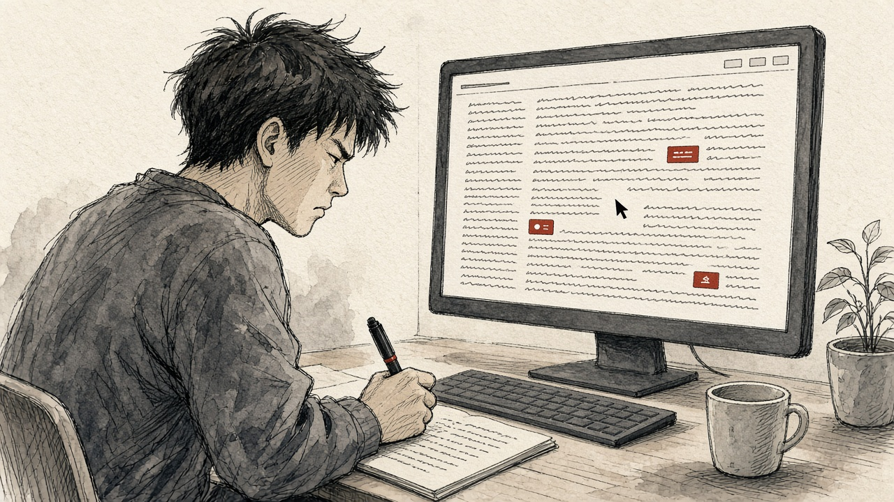
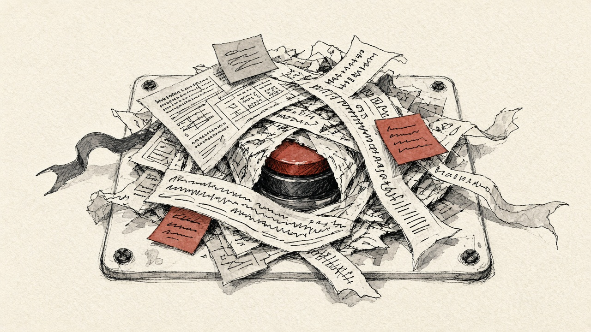

这一两年，AI 出现之后，做软件的成本越来越低了。可大家大概都感觉到了，AI 做出来的软件，一看就有一股 AI 味儿。交互、审美跟以前不太一样，又说不清到底怪在哪。专业设计师怎么做，我先不谈。现在人人全栈，也都在讲 AI Builder。今天只想聊其中一个小细节：生成式文案和引导说明的滥用。

我说的不是配色、圆角，也不是某一家模型的文风有多像。更常见的是，打开一个刚做出来的产品，空白处先迎上来一段自我介绍，按钮旁边跟着一句解释，助手还没等你开口，就已经列出它能做的十件事。你还没开始干活，先要判断这些字要不要看、能不能跳过、看完到底要你做什么。

怪，往往就怪在这儿。不是功能太少，是话太多。

就拿我最近让 AI 做的一个 demo 来说。开关、字段和选项旁边，都跟着说明。

## 先去掉一半文字，再去掉一半

这件事其实不新鲜。Steve Krug 在《Don't Make Me Think》（中译《点石成金》）里说得很直白：好的界面应当显而易见、不言而喻；每个页面先去掉一半文字，再把剩下的去掉一半；指示说明必须消灭，让功能和交互自己说话。

站酷上 Hi海哥的文章[《别让我思考，让产品更易用，记住这“321法宝”》](https://www.zcool.com.cn/article/ZMTAzMTEwMA==.html)把这些归纳成三个准则、两个认知、一个测试，核心还是那一句：别让我思考。他还提到，人们不是在精读页面，而是在扫描；可用性，是让一个能力普通的人不必过度费力就能用下去。

新的地方只是，生成式模型出现以后，往页面上堆文字几乎不花成本。交互没说清楚的时候，最便宜的补法就是再写一段说明。按钮不清楚，就加一句提示；流程不清楚，就生成一段引导；能力边界不清楚，就在空状态里写一篇功能清单。锤子在手，看什么都像钉子。

## 还没点击，先要读完一段话

Krug 说，点击多少次都没关系，只要每次点击都是无须思考、明确无误的选择。现在常见的情况正好反过来：还没点击，先要读完一段话，才能决定点哪里。

命名也是如此。Ask、Agent、Plan、Composer，词本身不一定有错，可如果每个词都得配一句说明才知道差别，那思考已经发生了。Hi海哥提过命名、是否可点、位置这些陷阱，放在今天依然好用。多出来的那一步，常常是在判断这段话是在介绍、在建议，还是已经开始替我做事。

为扫描而设计，跟生成式文案的习惯几乎是对着来的。模型默认会把话说完整、说客气、说周全，还喜欢先总结再展开。这种文字一留在页面上，视觉层次就被摊平了：真正能点的东西，和只是在说话的东西，混在一起。看引导，等于在做阅读理解。

## 别用说明去补交互

我不是反对用 AI 写文案，也不是反对产品里出现助手。别扭的是用生成出来的字，去补一块本该由交互完成的工作。

一个按钮如果需要一段话才能解释清楚，问题多半在按钮，不在字不够多。空状态如果只是在介绍产品自己，而不让下一步显而易见，那它就是一段挪了位置的说明书。

vibe coding 也是这样。工具变得很好说话，并不等于所有入口都要先让你说明自己想做什么。运行测试、提交更改、打开这张图，有的事本来就是一个明确的操作。先绕进对话，再读完一段生成的确认，不见得比直接做一个看得懂的控件更聪明。

真要花脑子，也应该花在工作本身上，而不是花在猜工具此刻在说什么。

文字变得便宜，并不能自动变成好的说明。生成之后仍该砍，能设计掉的说明就不必放在页面上。少一点 AI 味儿，是让下一步显而易见。把话说得更像人，解决不了这件事。

## 怎么控制 AI 产出这股味儿

生成之后要砍，是一回事。另一回事是，现在给编程助手用的 skill，已经有一批专门对付界面上的这股味儿。先要分清它们在管什么。眼下比较流行的，大多管视觉：不要紫渐变，不要千篇一律的默认字体和卡片骨架。已经有一个界面，再拿去改，也有现成的做法。

- [frontend-design](https://github.com/anthropics/skills/tree/main/skills/frontend-design)，Anthropic 出的，让生成出来的界面避开那些一眼就能看出来的默认样式
- [Hallmark](https://github.com/Nutlope/hallmark)，带 audit 和 redesign，适合拿已有的落地页来改，不太适合复杂后台
- [Impeccable](https://github.com/pbakaus/impeccable)，定位是上线前把 AI slop 抓住
- [画书设计](https://github.com/alchaincyf/huashu-design)，中文社区里比较常见，重点是做出风格，不是改说明文字

这篇真正想说的，是说明和引导写太多。这件事上，流行的 skill 反而很少。[anti-ai-copy](https://github.com/yzfly/skills/tree/main/skills/anti-ai-copy) 对标了 Krug 的先删再写，但几乎还没有流行起来。skill 能帮你避开一套默认审美，却不能替你决定：这段话是不是根本不该出现。

## 打磨好软件，依然不是一件简单的事

AI 产出变快了，人也会跟着浮躁。一屏界面很快就能铺出来，改一轮也只要再说一句。可把一个软件打磨到真正好用，依然不是一件简单的事。

工具越来越能写、能画、能出完整页面，用户却不会因此就留下来。功能很快就会被追上。一个好的软件要留住用户，最终可能还是赢在体验上：下一步是不是显而易见，还是先要读完一段话，才能决定点哪里。
